  <picture>
    <source media="(prefers-reduced-motion: reduce)" srcset="assets/crystal-atelier.png">
    
  </picture>

<h3 align="center"><samp>ange@crystal ~ welcome back</samp></h3>

You found a terminal with the lights still on. Someone who likes opening black boxes and stepping into stories. From OS and systems to AI and agents, compiling curiosity into small things that run.

<a href="README.md">中文</a> · <a href="README.en.md">EN</a>

<a href="https://angecrystal.github.io/AngeCrystal/en/"><picture>
    <source media="(prefers-reduced-motion: reduce)" srcset="assets/terminal-demo.en.static.svg">
    
  </picture></a> <a href="https://angecrystal.github.io/AngeCrystal/en/">Click the terminal to type your own commands ↗</a>

 <samp>There is always another layer to explore.</samp> Session stays open. Bring a question, or a new game.

