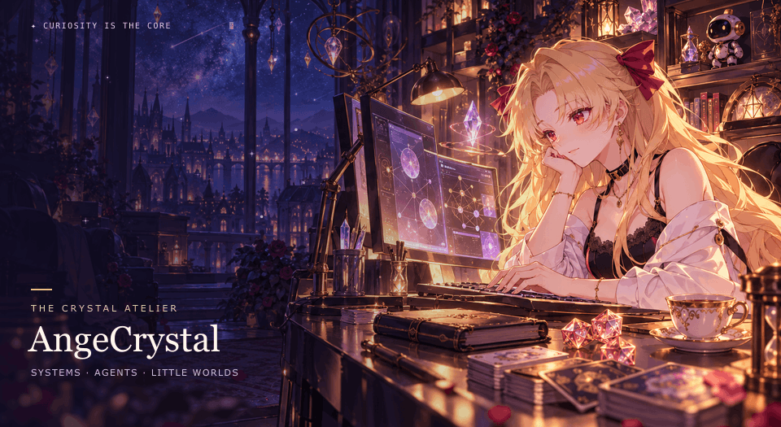

  <picture>
    <source media="(prefers-reduced-motion: reduce)" srcset="assets/crystal-atelier.png">
    
  </picture>

<h3 align="center"><samp>ange@crystal ~ welcome back</samp></h3>

你发现了一个还亮着灯的终端。 一个喜欢拆开黑箱、也喜欢走进故事的人。 从 OS、系统到 AI 和 Agent，把好奇心编译成可以运行的小东西。

<a href="README.md">中文</a> · <a href="README.en.md">EN</a>

<a href="https://angecrystal.github.io/AngeCrystal/"><strong><samp>guest@crystal:~ $ 打开交互终端 ↗</samp></strong></a> 在网页终端里输入 <code>/help</code>，看看里面藏着什么。

 <samp>There is always another layer to explore.</samp> 会话保持开放。欢迎带着一个问题，或一局新游戏回来。

